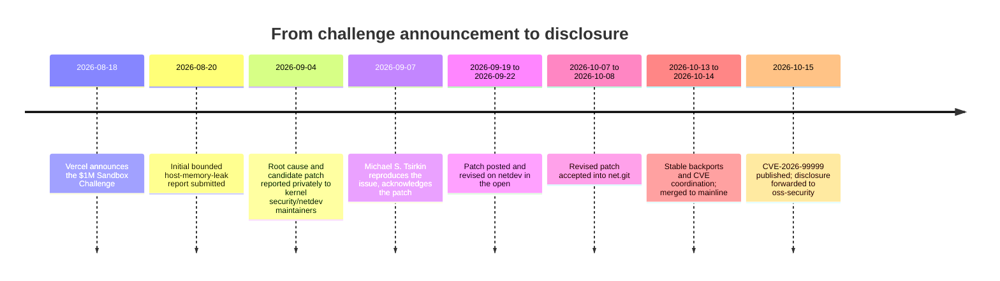

# PwnEscape: A Guest-to-Host Memory Leak via IPv4 Checksum Offload

> CVE-2026-99999 — a guest's own checksum-offload metadata, taken at face value by the host's network stack, lets it mutate an IPv4 header the host had already finished with and leak host memory back out through the packet

Disclosed
:   Initial bounded disclosure 2026-08-20; root cause and candidate patch reported privately to kernel security/netdev maintainers 2026-09-04; CVE published 2026-10-15 (oss-security forward of the PWNAI Research write-up)

Reported / found by
:   Paulos Yibelo (PWNAI Research / pwn.ai), during Vercel's "$1 Million Sandbox Challenge" (announced 2026-08-18) — the finding arrived on day three of the two-week program

CVSS
:   9.3 CRITICAL (NVD, `CVSS:3.1/AV:L/AC:L/PR:N/UI:N/S:C/C:H/I:H/A:H`) · CWE-20 (Improper Input Validation)

Fixed in
:   mainline 7.3 (commit `6785011f8b16`, authored and accepted into `net.git` 2026-10-07/08, merged via the `net-7.3-rc7` pull 2026-10-14); backported same-day to seven stable branches as separate commits

Exploit tool
:   not published — pwn.ai's write-up withholds the memory-allocation-control and host-write mechanics for an unpublished "Part 2"

Actively exploited
:   no confirmed cases; the published disclosure demonstrates a host-memory leak against Vercel's own production sandboxes, but the further host-write and root-execution chain was shown only on the researcher's own lab machines, not in production

*Part of [War Stories: Network Stack Bugs and CVEs](../war-stories.md).*

## What happened

A security researcher taking part in a cloud provider's public bug-bounty challenge found that a virtual machine's guest could hand the host's network stack a packet with self-contradictory metadata — correct enough to pass the checks the kernel already runs, but able to rewrite part of the packet's own header *after* those checks had already relied on it being well-formed. The rewrite could turn a 20-byte IPv4 header into one the kernel believed was 60 bytes long, and the 40 bytes of "header" that didn't actually exist got filled in from whatever host memory happened to sit next to the packet — which then went out over the network, to the guest that asked for it.

The bug itself isn't inside KVM, Firecracker, or any hypervisor's own code. It's in ordinary IPv4 packet handling that every Linux host runs regardless of virtualization; what makes it a guest-to-host issue is that virtual-machine networking (`tun`/`tap` devices carrying `virtio_net_hdr` metadata) is one of the paths that hands a guest direct control over the fields the bug depends on.

## How the code was vulnerable

Linux lets a sender defer a packet's checksum to be filled in later, rather than computing it up front — `CHECKSUM_PARTIAL`. The sender (or, for virtual networking, the guest) supplies two offsets: `csum_start`, where the checksum calculation should begin, and `csum_offset`, where the finished 2-byte result should be written, relative to `csum_start`. `skb_checksum_help()` is what actually does this later, and — checked against `net/core/dev.c` at the pre-fix `v7.3-rc6`-era tag — its own bounds checking only looks at whether the write stays inside the packet's linear data, never at whether `csum_start` is far enough *into* the packet to land after the IPv4 header it's about to still be read as:

```c
offset = skb_checksum_start_offset(skb);
ret = -EINVAL;
if (unlikely(offset >= skb_headlen(skb))) {
    /* ...bails out... */
}
csum = skb_checksum(skb, offset, skb->len - offset, 0);

offset += skb->csum_offset;
if (unlikely(offset + sizeof(__sum16) > skb_headlen(skb))) {
    /* ...bails out... */
}
ret = skb_ensure_writable(skb, offset + sizeof(__sum16));
if (ret)
    goto out;

*(__sum16 *)(skb->data + offset) = csum_fold(csum) ?: CSUM_MANGLED_0;
```

Both checks only bound the write from *above* (it can't run past the end of the linear data) — neither one stops `csum_start` from pointing *inside* the IPv4 header itself, well before where a real transport-layer checksum would ever start. If an attacker picks `csum_offset` so the 2-byte write lands on the header's first byte — where IP packs the 4-bit version and 4-bit IHL (header-length) fields together — the computed checksum's low nibble becomes the new IHL, attacker-chosen, up to its maximum value of 15 (a claimed 60-byte header instead of the real 20).

The second half of the bug is pure ordering. `ip_do_fragment()` — checked against `net/ipv4/ip_output.c` at the same tag — calls `skb_checksum_help()` *before* it reads the header it's about to fragment:

```c
/* for offloaded checksums cleanup checksum before fragmentation */
if (skb->ip_summed == CHECKSUM_PARTIAL) {
    err = skb_checksum_help(skb);   /* pre-fix: no validation of csum_start here */
    if (err)
        goto fail;
}

/* Point into the IP datagram header. */
iph = ip_hdr(skb);
...
hlen = iph->ihl * 4;
```

By the time `hlen` is computed, the checksum write has already run — so if it corrupted `iph->ihl`, `ip_do_fragment()` trusts the corrupted value for how much "header" to copy into the first fragment. Per the disclosure, the packet's real linear data ran out at 28 bytes; told the header was 60, the fragmenting code copied 32 bytes past the end of what the packet actually contained — and whatever host memory happened to sit there went out as spurious IP options in the emitted packet.

`skb_checksum_help()` isn't only reachable from `ip_do_fragment()` — the same missing check applied to four other call sites the fix touches: netfilter's `CHECKSUM` target, `nfnetlink_queue`, bridge connection tracking, and IPsec output. Any of them completing a checksum on attacker-steered metadata hits the same gap; `ip_do_fragment()` is simply the one the published disclosure walks through in detail.

The two kernel features that hand a guest this kind of control over `csum_start`/`csum_offset` in the first place substantially predate the bug: `tun`'s `IFF_VNET_HDR` support, letting a `tun`/`tap` device accept a `virtio_net_hdr` prefix carrying GSO and checksum metadata, landed in 2008 (commit [`f43798c2`](https://git.kernel.org/pub/scm/linux/kernel/git/torvalds/linux.git/commit/?id=f43798c27684764ad7bc3d16a59ff01bf2a8e21e), "tun: Allow GSO using virtio_net_hdr"); `af_packet`'s equivalent `PACKET_VNET_HDR` socket option followed in 2010 (commit [`bfd5f4a3`](https://git.kernel.org/pub/scm/linux/kernel/git/torvalds/linux.git/commit/?id=bfd5f4a3d6058fb059f194ac4350db080899896f), "packet: Add GSO/csum offload support."). Neither commit is at fault — `virtio_net_hdr` is the normal, documented way a guest's virtio-net device hands checksum-offload metadata to the host, exactly as a real NIC's hardware offload would; the gap is in how the host's general-purpose checksum completion trusted that metadata once it arrived, nearly two decades of kernel history later.

## The leak

Paulos Yibelo's write-up (pwn.ai) frames the bug as a logical out-of-bounds read, triggered without any race or timing dependency — a single crafted packet, with checksum metadata chosen to overwrite the IHL field, is enough on its own. The disclosure reports 32 bytes of host memory leaked per occurrence, continuously, for as long as the guest keeps sending — and demonstrates this against Vercel's actual production sandbox fleet, not only a lab setup.

The write-up explicitly does not publish what comes after the leak. It describes achieving "selected 64-byte host-kernel writes" and running a host-root helper across four cold boots — but only on the researcher's own disposable KVM/Firecracker machines, configured to match Vercel's setup, never against production. The allocator-control technique that turns a repeatable 32-byte leak into a controlled write, and the mechanics of the write and execution steps themselves, are deliberately withheld for a follow-up ("Part 2") that hadn't been published as of this page's sources. Treat the leak itself as demonstrated and the host-write/code-execution chain as reported, not independently verified here.

Yibelo's own post is careful to separate two different claims that press coverage tended to blur: *escaping a sandbox's network isolation* (what the disclosed leak does) and *escaping a VM to the underlying host* (what the lab-only write/execution chain claims to do). The bug itself lives in ordinary host IPv4 code — not inside KVM, Firecracker, or any other hypervisor's own implementation — a point Edera's Alex Zenla made to CSO Online in the same terms: *"When a guest breaks out, it isn't escaping into some neatly contained hypervisor."* "KVM escape" and "VM escape," as used in coverage of this bug, name the trust boundary the researchers crossed in their own lab, not the component that actually contained the flaw.

## How it was found

Yibelo's write-up credits the discovery to a research campaign — the "Omega-Pwn" harness paired with an AI model ("GPT-5.6 Sol") for source-level analysis, under human direction — reaching the underlying primitive in about three days. The write-up doesn't claim the AI found or exploited the bug unassisted; as with this collection's other AI-assisted finds, the human researcher directed the search and did the verification.

The reported timeline, from the write-up and its oss-security forward:



The fix's own `Closes:` tag points to a [netdev posting](https://lore.kernel.org/netdev/20260922030310.8684-2-habte.yibelo@gmail.com/) from Yibelo dated September 22 — consistent with the write-up's account of the patch moving from a private report in early September to ordinary public review on netdev by late September, a routine path once a fix is just a hardening patch under normal review rather than something needing a continued embargo.

## The impact

What's demonstrated, and where: a continuous 32-byte host-memory leak into attacker-visible network traffic, shown against Vercel's production sandbox fleet. What's *reported but not independently verifiable from public sources*: a chain from that leak to controlled host-kernel writes and root code execution, demonstrated by the researchers only on their own disposable lab machines built to match Vercel's configuration — across four cold boots, with the technique that makes it reliable (allocator control) explicitly withheld.

Vercel's own account of the finding states that no reports showed anyone accessing customer data, and distinguishes the memory-leak finding (shown in production) from the crash and code-execution findings (shown only on the researchers' own matching hardware). The $1,000,000 challenge paid out $242,000 in total bounties across its full two-week run; the write-up doesn't state how much of that went to this specific finding.

Because the vulnerable code is generic IPv4 handling, not anything KVM- or Firecracker-specific, the exposure isn't limited to Vercel. AWS's own guidance states that self-managed KVM hosts using `virtio-net`/TAP networking need to patch, while its managed EC2, Lambda, and Fargate services are not affected. Red Hat lists OpenShift Container Platform among affected components.

## How it was fixed

The fix, commit [`6785011f8b16`](https://git.kernel.org/pub/scm/linux/kernel/git/torvalds/linux.git/commit/?id=6785011f8b16abf40b1e9d8b2e332232b3e68822) ("ipv4: validate checksum_start before completing checksum," Michael S. Tsirkin, Red Hat), adds a new helper to `include/net/ip.h`:

```c
static inline int ip_check_csum_start(const struct sk_buff *skb)
{
    if (unlikely(skb->csum_start < skb->network_header + ip_hdrlen(skb)))
        return -EINVAL;
    return 0;
}
```

— and calls it immediately before `skb_checksum_help()` at every IPv4 site the fix touches: `ip_do_fragment()`, bridge netfilter's connection-tracking fragmentation path, `nfnetlink_queue`'s checksum-help path, the `CHECKSUM` netfilter target, and IPsec's `xfrm_output()`. Each site now refuses to complete the checksum at all if `csum_start` doesn't point at or after the end of the IPv4 header — closing off the specific corruption this disclosure used, without changing how legitimate deferred checksums behave.

The commit message is explicit that this is a defense-in-depth patch, not a full redesign of how the kernel trusts checksum-offload metadata from an untrusted source: *"We really shouldn't allow such packets in, but as a defence in depth measure, let's also check before we complete the checksum. A more complete validation at input is forthcoming, but needs more work."* Reviewed by Willem de Bruijn (Google); authored and accepted into `net.git` October 7–8, 2026; merged to mainline October 14 via the `net-7.3-rc7` pull. The same day it landed upstream, it was backported as seven separate stable commits; public reporting lists the covered branches as 5.10, 5.15, 6.1, 6.6, 6.12, 6.18, and 7.2, though this page hasn't independently confirmed which of the seven published stable-tree commit hashes maps to which branch.

## What it taught us

**Checksum-offload metadata from a guest is attacker input, not trusted hardware state, and the code path treating it that way was nearly two decades old.** `virtio_net_hdr` exists to let a guest's paravirtualized NIC describe offload work the way real hardware would — but real hardware doesn't get to overwrite the header fields the kernel is about to make routing and fragmentation decisions on. The gap wasn't that `tun` or `af_packet` did anything wrong in 2008 or 2010; it's that the general-purpose checksum-completion code they both feed into never added the one check that matters once its input can come from something less trustworthy than the local machine.

**Validate position, not just extent.** `skb_checksum_help()`'s existing checks were about *not overrunning* the packet — a real and necessary check, just not the one this bug needed. Nothing stopped the write from landing too *early*, inside a region the caller still needed to trust. A bounds check that only looks at one end of a range can still leave the other end wide open.

**A fix can be explicit about not being finished.** The patch that shipped doesn't claim to solve attacker-controlled checksum offload in general — its own commit message says fuller input-side validation is still pending. Landing the narrow, well-understood defense-in-depth check now, while saying plainly what's still open, is a reasonable way to ship a partial fix under real time pressure.

**Public disclosure can be real and incomplete at the same time.** The published write-up demonstrates a genuine, reproducible host-memory leak against production infrastructure, and is equally explicit about which further claims — host writes, root execution — it is *not* backing with public evidence. Both halves matter: the demonstrated leak is a real bug with a real fix, and the undemonstrated escalation chain is not yet something anyone outside the research team can verify.

!!! warning "Pattern to watch for"
    Any deferred or offloaded operation that writes into a buffer based on an offset supplied by the sender — a checksum, a length field, an alignment pad — needs that offset validated against the structure it's about to be read back as, not just against the buffer's own bounds. This applies most sharply wherever the sender can be a guest, a container, or any other principal less trusted than the code doing the deferred work; a check that was safe when every caller was local kernel code doesn't stay safe once an external party controls the inputs.

## See also

- [sk_buff: The Kernel's Packet Representation](../sk-buff.md) — `csum_start`, `csum_offset`, and `CHECKSUM_PARTIAL` in context
- [Container Networking](../container-networking.md) — `tun`/`tap` devices and the virtualized-networking path this bug reaches through
- [The net/sched act_api Filter-Delete Race](act-api-uaf.md) — another bug in this collection whose discovery process involved AI-assisted analysis

## External references

- [git.kernel.org: 6785011f8b16](https://git.kernel.org/pub/scm/linux/kernel/git/torvalds/linux.git/commit/?id=6785011f8b16abf40b1e9d8b2e332232b3e68822) — the fix, "ipv4: validate checksum_start before completing checksum"
- [git.kernel.org: f43798c27684](https://git.kernel.org/pub/scm/linux/kernel/git/torvalds/linux.git/commit/?id=f43798c27684764ad7bc3d16a59ff01bf2a8e21e) — "tun: Allow GSO using virtio_net_hdr" (2008), one of two `Fixes:` targets
- [git.kernel.org: bfd5f4a3d605](https://git.kernel.org/pub/scm/linux/kernel/git/torvalds/linux.git/commit/?id=bfd5f4a3d6058fb059f194ac4350db080899896f) — "packet: Add GSO/csum offload support." (2010), the other `Fixes:` target
- [lore.kernel.org: Yibelo's netdev posting](https://lore.kernel.org/netdev/20260922030310.8684-2-habte.yibelo@gmail.com/) — the `Closes:` link on the fix commit
- [NVD: CVE-2026-99999](https://nvd.nist.gov/vuln/detail/CVE-2026-99999) — CVSS 9.3 (`AV:L/AC:L/PR:N/UI:N/S:C/C:H/I:H/A:H`), CWE-20
- [pwn.ai: PwnEscape](https://pwn.ai/blog/pwnescape) — Paulos Yibelo's own write-up; withholds the host-write/execution chain for a planned Part 2
- [Vercel: Findings from the $1 Million Vercel Sandbox Challenge](https://vercel.com/blog/findings-from-the-1-million-dollar-vercel-sandbox-challenge) — Vercel's own account, including which parts were demonstrated in production versus researcher-owned hardware
- [oss-security: forward of the PWNAI Research write-up](http://www.openwall.com/lists/oss-security/2026/10/15/5) — Jan Schaumann's public disclosure forward
- [CSO Online: Linux kernel gets a fix for a flaw that enabled attackers to escape VMs](https://www.csoonline.com/article/4236460/linux-kernel-gets-a-fix-for-a-flaw-that-enabled-attackers-to-escape-vms.html) — Lucian Constantin's coverage
- [CSO Online: KVM escape exposes broader attack surface in Linux networking](https://www.csoonline.com/article/4237999/kvm-escape-exposes-broader-attack-surface-in-linux-networking.html) — follow-up coverage, including AWS's guidance and Alex Zenla's (Edera) comment on the VM-escape framing
